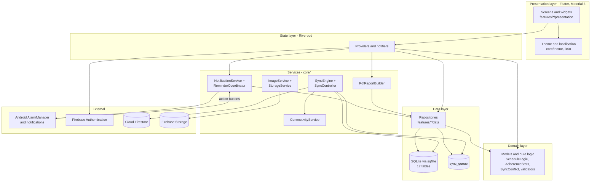
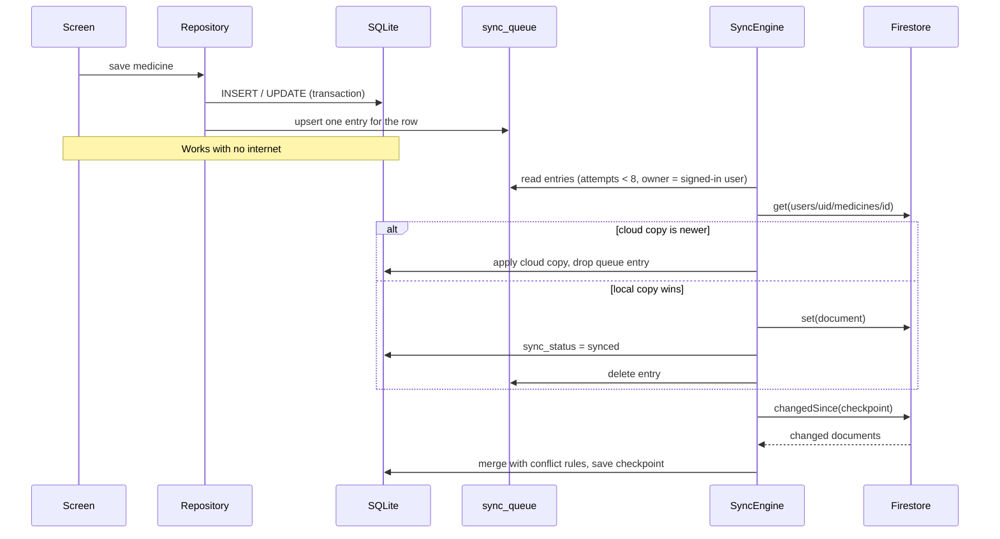

# MediTrack – Architecture

MediTrack is a **feature-first, layered** Flutter app. Each feature folder (`lib/features/<name>/`) has
`data/` (repositories), `domain/` (models + pure logic) and `presentation/` (screens, providers).



## Folder structure (summary)
```
lib/
  main.dart                 start-up: Firebase (optional), notifications, ProviderScope
  firebase_options.dart     PLACEHOLDER until you run `flutterfire configure`
  app/                      app.dart (MaterialApp), app_root.dart (splash/onboarding/login/main), router.dart (bottom nav)
  core/
    database/               schema, migrations, AppDatabase, BaseRepository (CRUD + sync queue)
    notifications/          NotificationService, ReminderCoordinator
    sync/                   SyncEngine, RemoteStore (Firestore), SyncController, ConnectivityService
    services/               settings providers, ImageService, StorageService, active profile
    theme/                  app_colors, app_theme, app_text_styles, app_spacing, app_dimensions
    utils/                  validators
  features/                 authentication, dashboard, medicines, schedules, notifications, medicine_logs,
                            inventory, family, health_records, reports, appointments, settings
  shared/widgets/           confirm dialog
  l10n/                     app_en.arb, app_bn.arb (+ generated app_localizations*.dart)
test/  integration_test/  docs/  firebase/  tool/
```

## Key design decisions
1. **Offline-first.** Screens read and write SQLite only. The cloud is a copy, never a dependency.
2. **Repository pattern.** UI never writes SQL. `BaseRepository` gives insert/update/soft-delete and queues a sync entry in the same transaction.
3. **Riverpod.** `FutureProvider`s expose data; invalidating a provider refreshes a screen. Session, theme, language and the active family profile are small notifiers.
4. **Pure logic is separate and tested.** `ScheduleLogic` (which doses exist), `AdherenceStats`, `DateRange`, `SyncConflict`, `HealthValidators`, `Validators`, `InventoryItem.statusOn`.
5. **No medical interpretation.** Health values are validated only for typing mistakes; adherence is a record of reminders.

## Main flows
**Reminder.** `refreshReminders` (app start, any change) → `ReminderCoordinator.rescheduleAll` computes doses for the next 7 days →
`NotificationService.scheduleAt` → Android alarm. Buttons *Taken / Snooze / Skip* call `handleNotificationResponse`, which opens the
database (even if the app is closed) and records the result. Boot receivers re-register alarms after a restart.

**Taken dose.** `IntakeRepository.record` → upsert the log (unique per dose) → `InventoryRepository.deductForLog` (unique per log) → sync entry queued.

**Sync.** See the sequence diagram below. Triggers: app start, network regained, every minute when something is waiting, every 5 minutes for downloads, "Sync now".



### Conflict rules (same result on every device)
1. A dose the user decided (taken / skipped) beats an automatic "missed".
2. Otherwise newest `updated_at` wins.
3. Exact tie: the larger id wins.
Deletions are tombstones and follow the same rules. Two logs for the same dose created on two phones are merged into one.

## Security
* Firebase Authentication (email + password). Session persists across restarts.
* Firestore rules: `users/{uid}/…` readable/writable only by that uid; hard deletes are denied.
* Storage rules: `users/{uid}/…` only that uid; images only; under 5 MB.
* The sync engine uploads a queue entry only if its row belongs to the signed-in user, and rejects downloaded documents whose `user_id` differs.
* No private keys are in the project. `firebase_options.dart` holds only public client identifiers and is generated on your computer.
* Family data: a profile only gets missed-dose alerts after an explicit consent confirmation (stored with a timestamp).

## Known limitations
See PROJECT_REPORT.md §21 and PROGRESS.md.
