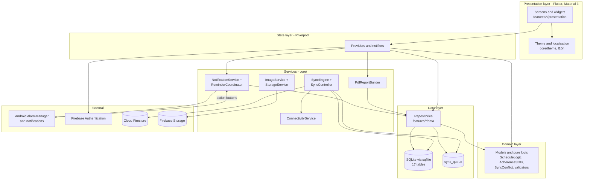
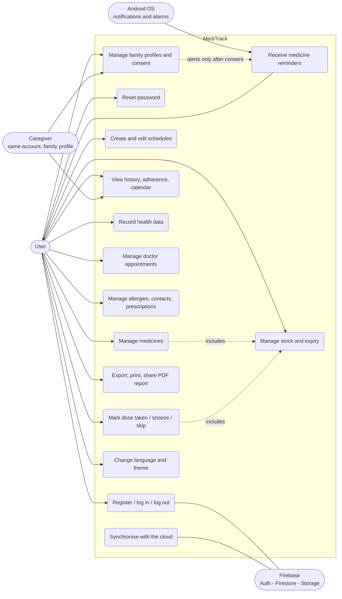
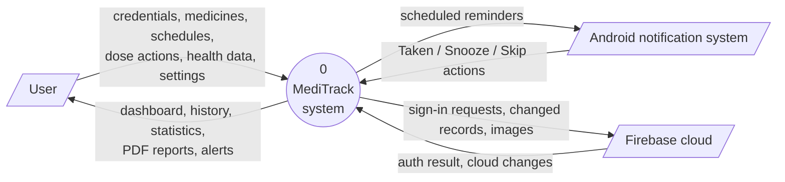
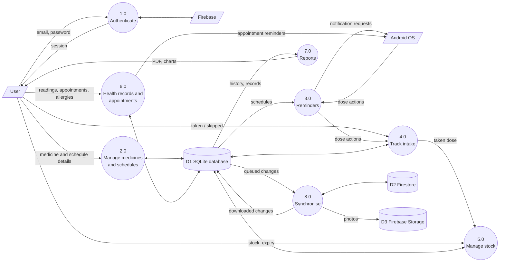
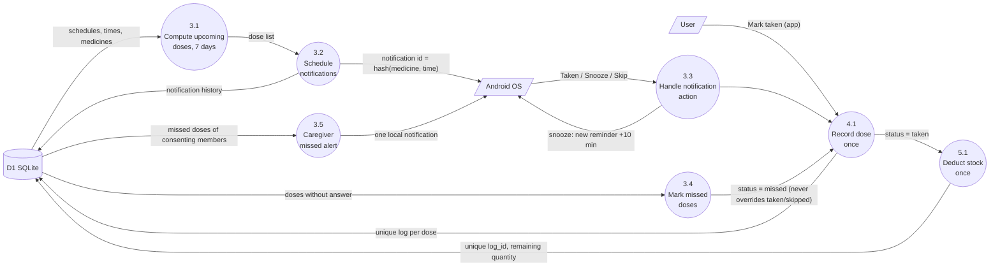
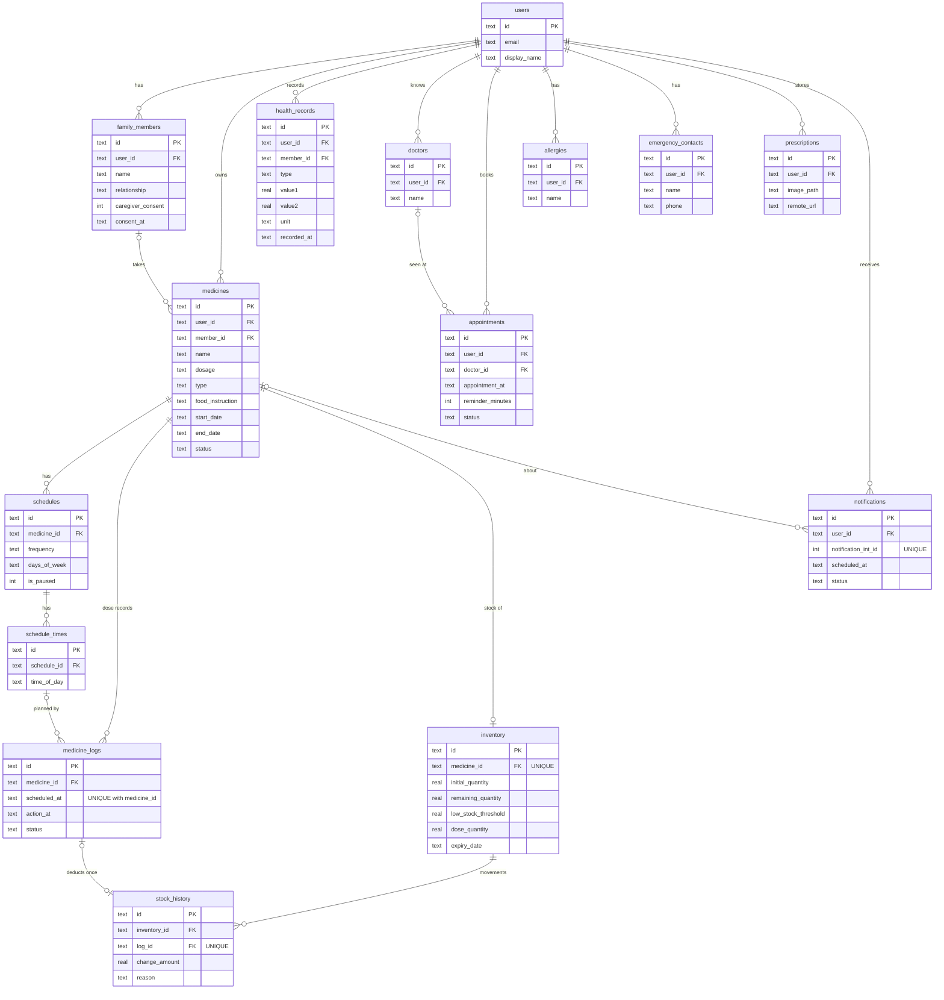

# MediTrack – Smart Medicine Reminder & Personal Health Management System

## 1. Cover page

| | |
|---|---|
| **Project title** | MediTrack – Smart Medicine Reminder & Personal Health Management System |
| **Project type** | Individual project |
| **Submitted by** | [Your full name] |
| **Student ID** | [ID] |
| **Programme / Department** | [Programme], [Department] |
| **University** | [University name] |
| **Supervisor** | [Supervisor name, title] |
| **Submission date** | [Date] |

---

## 2. Abstract

People who take regular medicines often forget doses, lose track of how many tablets are left, and cannot easily show
their history to a doctor. MediTrack is an Android application, built with Flutter, that helps a person remember and record
their medicines. It provides reminders with *Taken*, *Snooze* and *Skip* actions, intake history and adherence statistics,
stock and expiry tracking, separate profiles for family members (with consent), health records (blood pressure, glucose,
weight), doctor appointments, allergies, emergency contacts, prescription photos and PDF reports in English and Bangla.
The application follows an **offline-first** design: all data is stored immediately in SQLite and copied to Firebase
(Authentication, Cloud Firestore, Storage) by a synchronisation engine that uses a change queue, conflict rules, retries and
deletion tombstones. MediTrack is a record-keeping and reminder tool only; it does not diagnose, prescribe or advise on dosage.
The report describes the requirements, design, implementation and testing approach. *(Test results are to be added after the
tests are run – see §20.)*

**Keywords:** medicine reminder, Flutter, offline-first, SQLite, Firebase, medication adherence.

---

## 3. Introduction

Mobile phones are always with their owners, which makes them a natural place for medicine reminders. Many existing apps need
constant internet, show only simple alarms, or mix reminders with medical advice. In countries and areas with unreliable
connectivity, an app must keep working offline and synchronise later. MediTrack was designed to meet these needs for a
single user and their family, in English and Bangla.

## 4. Problem statement

1. Patients forget doses or take them at the wrong time.
2. People do not know when their stock will run out or when a medicine expires.
3. Caring for a family member means managing several medicine lists by memory.
4. Doctors receive incomplete, hand-written histories.
5. Apps that need permanent internet fail when the connection is poor.
6. Many apps blur the line between reminders and medical advice, which can be unsafe.

## 5. Objectives

1. Build a working Android app that schedules reliable medicine reminders with one-tap actions.
2. Record every dose (taken / missed / skipped) exactly once and calculate adherence.
3. Track stock and expiry and prevent double stock deduction.
4. Support family profiles with explicit caregiver consent.
5. Store health records, appointments, allergies and contacts, and export a PDF report.
6. Work fully offline and synchronise safely with the cloud, keeping each user's data private.
7. Provide an English and Bangla interface with light and dark themes in one consistent design system.
8. Stay strictly a reminder / record-keeping tool (no diagnosis, prescribing, or dosage advice).

## 6. Project scope

**In scope:** Android phones (Material 3), 10 modules (authentication, medicines, scheduling, notifications, intake tracking,
stock and expiry, family, health records, appointments, additional features), SQLite + Firebase, English and Bangla.

**Out of scope:** iOS and web builds, medical interpretation of readings, drug-interaction checking, barcode scanning,
integration with pharmacies or hospital systems, push notifications to another person's device (needs a server), and
cloud deletion of uploaded images.

## 7. Feasibility study

| Type | Assessment |
|---|---|
| **Technical** | Flutter, Dart, SQLite and Firebase are mature, free to start with and well documented. A single code base targets Android. All required capabilities (local notifications, charts, PDF) exist as maintained packages. |
| **Economic** | Software cost is zero (open-source tools, Firebase free allowance). Firebase Authentication and Firestore have free usage tiers; Cloud Storage may need the pay-as-you-go plan for new projects, so the app keeps photos on the phone if Storage is not enabled. |
| **Operational** | The app targets everyday users: large touch targets (48 px), clear colours, Bangla support, notification buttons so that reminders can be handled without opening the app. |
| **Schedule** | Developed in 11 phases (setup → database → authentication → medicines → notifications → tracking → family/health → reports → sync → testing → delivery). |
| **Legal / safety** | Health data is private: per-user storage, owner-only security rules, explicit consent for family monitoring, and a visible disclaimer that the app gives no medical advice. |

## 8. Functional requirements

| ID | Requirement |
|---|---|
| FR-01 | The user can register, log in, log out, reset the password and keep the session after restarting the app. |
| FR-02 | The user can add, edit, delete, search, filter and sort medicines (name, dosage as prescribed, type, food instruction, dates, photo, status). |
| FR-03 | The user can create daily, weekly or custom-day schedules with several times per day, start/end dates, pause and resume. |
| FR-04 | The app sends a reminder at each scheduled time with Taken, Snooze and Skip actions, including after a phone restart. |
| FR-05 | The app records each dose once and shows daily, weekly and monthly history, adherence %, charts and a calendar, filterable by medicine and date. |
| FR-06 | The app tracks stock, deducts it once per taken dose, warns about low stock and expiry, and keeps a stock history with manual adjustments. |
| FR-07 | The user can manage family members with separate medicines, schedules and history; missed-dose alerts require recorded consent. |
| FR-08 | The user can record blood pressure, glucose, weight, notes and medical history, see charts and filter by date. |
| FR-09 | The user can manage doctor appointments with reminders, upcoming list and history. |
| FR-10 | The user can store allergies, emergency contacts and prescription photos. |
| FR-11 | The user can export, print and share a PDF report. |
| FR-12 | The app works offline and synchronises with Firebase when online (queue, conflicts, retries, deletions). |
| FR-13 | The user can switch language (English/Bangla) and theme (light/dark). |

## 9. Non-functional requirements

| ID | Requirement |
|---|---|
| NFR-01 | **Reliability:** no data loss when offline; one record per dose; no duplicate stock deduction or notifications. |
| NFR-02 | **Security:** owner-only Firestore/Storage rules; per-user data isolation; no secrets in the code; image type and size checks. |
| NFR-03 | **Usability:** consistent Material 3 design system, 48 px touch targets, loading / empty / error states, form validation, confirmation dialogs. |
| NFR-04 | **Accessibility:** readable contrast in both themes, semantic labels, scalable text. |
| NFR-05 | **Maintainability:** feature-first architecture, repository pattern, pure logic separated and unit tested. |
| NFR-06 | **Performance:** local queries on indexed tables; reminders scheduled a rolling 7 days ahead. |
| NFR-07 | **Portability:** Android 6.0 (API 23) or newer. |
| NFR-08 | **Privacy / safety:** no diagnosis, prescribing or dosage advice; disclaimer shown on key screens. |

## 10. System architecture

MediTrack uses four layers: presentation (screens), state (Riverpod providers), domain (models and pure logic) and data
(repositories over SQLite). Services handle notifications, synchronisation, images and PDF. Details are in `docs/ARCHITECTURE.md`.

## 11. Use case diagram

## 12. DFD – Level 0 (context diagram)

## 13. DFD – Level 1

## 14. DFD – Level 2 (reminders, intake and stock)

## 15. Entity relationship diagram

## 16. Database design

The database has 17 normalised tables (16 required + `stock_history`) with primary keys (UUIDs), foreign keys, CHECK constraints,
unique constraints that prevent duplicate dose records and stock deductions, indexes, created/updated timestamps and soft deletion
(`deleted_at`). Multi-row operations use transactions. Full details: `docs/DATABASE.md`.

## 17. Implementation details

| Topic | Implementation |
|---|---|
| **Language / framework** | Dart, Flutter, Material Design 3 |
| **State management** | Riverpod (`FutureProvider`, `Notifier`) |
| **Local database** | sqflite; schema in `core/database/schema.dart`; migrations in `migration_manager.dart` |
| **Repository pattern** | `BaseRepository` (CRUD + soft delete + sync-queue entry in the same transaction); feature repositories extend it |
| **Authentication** | Firebase Authentication (email/password); session restored automatically; offline-only mode when Firebase is not set up |
| **Scheduling** | `ScheduleLogic.dosesBetween` (pure function) computes doses; weekdays 1–7; respects pause, schedule and medicine date ranges |
| **Notifications** | `flutter_local_notifications` with absolute UTC instants; deterministic ids (hash of medicine + dose time); exact alarms when permitted; action buttons processed even when the app is closed; boot receiver re-registers alarms |
| **Intake tracking** | `IntakeRepository.record`, unique per dose; automatic *missed* after 60 minutes (looks back 14 days, never before a schedule was last changed) |
| **Stock** | `InventoryRepository.deductForLog` – transaction + UNIQUE(log_id); reversal if Taken is changed; reconcile safety net |
| **Family** | `activeMemberProvider` selects the profile; repositories filter by `member_id`; consent stored with timestamp; caregiver alert only for consenting members |
| **Health records** | Validation only for impossible values; charts with `fl_chart` using one unit at a time |
| **Reports** | Adherence statistics, pie and bar charts, calendar (`table_calendar`), PDF with `pdf` + `printing` |
| **Synchronisation** | `SyncEngine` + `RemoteStore` (Firestore). Upload queue, download by `updated_at` checkpoint, conflict rules, retries (max 8, then parked), tombstones, per-user ownership check |
| **Localisation** | ARB files `app_en.arb` / `app_bn.arb` (280 keys each); Inter and Noto Sans Bengali fonts |
| **Theme** | `core/theme/*`: all colours in `app_colors.dart`; light and dark `ThemeData` with `ColorScheme` |
| **Security** | `firebase/firestore.rules`, `firebase/storage.rules`, input validation, safe image upload, no embedded credentials |

### Safety design
The app never labels a health reading as high, low or normal; adherence is described as "a record of your reminders, not medical
advice"; dosage text is entered by the user "as prescribed" and never suggested or changed; a disclaimer appears on the dashboard,
settings, onboarding and PDF.

## 18. Testing methodology

* **Unit tests** for pure logic and repositories using an in-memory SQLite database (`sqflite_common_ffi`).
* **Widget tests** for login, dashboard, medicine list, add form, navigation and theme/language switching, with data providers replaced by in-memory fakes.
* **Sync tests** with a fake cloud store to simulate offline, retries, conflicts, tombstones and account isolation.
* **Integration tests** that drive the real app on an emulator/phone.
* **Manual test cases** (see below and `docs/TESTING.md`) for notifications, reboot behaviour, two-phone sync and rules.
* **Static analysis:** `flutter analyze`.

## 19. Test cases

See `docs/TESTING.md` for the automated test inventory and for the manual test table TC-01 … TC-18
(register, wrong password, validation, schedule, duplicate taken, snooze, missed, low stock, expiry, consent / no consent,
offline sync, conflict, dark/Bangla, PDF, reboot, rules).

## 20. Results

> **To be completed by the student after running the tests.** The author of the source code could not execute Flutter in the
> build environment, so no results are claimed here.

| Check | Command | Result (fill in) |
|---|---|---|
| Static analysis | `flutter analyze` | |
| Unit + widget tests | `flutter test` | passed __ / __ |
| Integration (offline) | `flutter test integration_test/offline_flow_test.dart` | |
| Integration (Firebase) | `flutter test integration_test/firebase_flow_test.dart ...` | |
| Release build | `flutter build apk --release` | APK size __ MB |
| Manual cases TC-01…TC-18 | see TESTING.md | |

## 21. Limitations

1. Code was written and statically checked but **not compiled or run** by its author; package versions were not verified.
2. Reminders are scheduled 7 days ahead and refreshed when the app opens; if the app is not opened for more than 7 days reminders stop. Changes downloaded from another phone are scheduled at the next app open.
3. Caregiver alerts appear on the account owner's phone only; alerting another person's device needs a server (Cloud Functions + push messaging).
4. Conflict resolution trusts device clocks; stock quantity is last-write-wins, so two phones deducting simultaneously can disagree.
5. Data created in "offline account" mode is not moved into a later cloud account.
6. PDF fonts are downloaded on first use; offline Bangla PDFs may miss characters.
7. Images are not deleted from Firebase Storage when a record is deleted; the profile photo is not synced to other devices.
8. Refill/expiry *notifications* are not implemented (warnings appear in the app).
9. Android only. Some phone brands restrict background alarms (battery settings must be relaxed).
10. Appointments are account-level (not separated per family member).

## 22. Future work

* Cloud Functions + Firebase Cloud Messaging for caregiver alerts on other phones and server-side reminders.
* Background WorkManager task to refresh reminders without opening the app; refill/expiry notifications.
* Barcode/QR scanning of medicine packs; OCR of prescriptions.
* Per-member appointments; shared (multi-account) family circles.
* Home-screen widgets, wearable support, iOS build.
* Encrypted local database and biometric lock.
* Server-side deletion/retention policies for images and tombstones.

## 23. Conclusion

MediTrack demonstrates a complete, offline-first mobile health-record and reminder system built with Flutter and Firebase. Its
main contributions are reliable duplicate-free dose and stock recording, a safe synchronisation design with explicit conflict
rules, family profiles with consent, and a consistent bilingual design system – all while remaining a record-keeping tool that
does not give medical advice. The remaining work is to run and tune the tests on real devices (see §20) and to address the listed limitations.

## 24. References

1. Flutter documentation – https://docs.flutter.dev
2. Dart language documentation – https://dart.dev/guides
3. Material Design 3 – https://m3.material.io
4. Riverpod – https://riverpod.dev
5. sqflite package – https://pub.dev/packages/sqflite
6. Firebase documentation (Authentication, Cloud Firestore, Cloud Storage, Security Rules) – https://firebase.google.com/docs
7. FlutterFire – https://firebase.flutter.dev
8. flutter_local_notifications package – https://pub.dev/packages/flutter_local_notifications
9. Android developers – Schedule alarms / exact alarms – https://developer.android.com/develop/background-work/services/alarms
10. fl_chart – https://pub.dev/packages/fl_chart ; pdf – https://pub.dev/packages/pdf ; printing – https://pub.dev/packages/printing ; table_calendar – https://pub.dev/packages/table_calendar
11. Mermaid diagram syntax – https://mermaid.js.org

*(Add the access date for each online source according to your university's referencing style.)*
